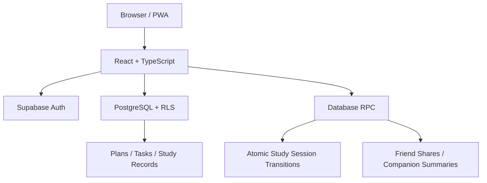

# StudyBloom

<p align="center">
  <strong>让每天的学习计划，慢慢开花。</strong>
</p>

<p align="center">
  
  
  
  
  
</p>

StudyBloom 是一个面向个人与学习搭子的学习计划日历。它把每日任务、专注计时、学习记录、目标统计和好友陪伴整合在一起，并通过 Supabase 在设备间同步数据。

## 功能一览

- **学习日历：** 月历视图、每日任务、排序、备注、休息日与计划复制。
- **学习目标：** 任务预计时长、实际累计时长和完成进度。
- **专注计时：** 自由计时与可配置番茄钟，支持暂停、继续和跨页面恢复。
- **学习地点：** 主动签到/签退，记录地点和有效学习时段。
- **统计复盘：** 每日目标、连续学习、学习模式分布、趋势和每周回顾。
- **好友系统：** 通过 StudyBloom ID 添加好友，接受邀请后可按所有者授权只读查看日历。
- **一起绽放：** 选择学习搭子，双方达到有效学习条件后生成共同记录；不做排行榜、不比较个人数据。
- **隐私分享：** 学习数据默认不分享，搭子概要按人授权并可撤销。
- **数据备份：** 支持 JSON 备份及学习会话、每日统计和隐私处理后的签到 CSV 导出。
- **PWA：** 支持添加到 iPhone / Android 主屏幕，提供静态资源预缓存、离线状态提示和版本更新提示。

## 学习闭环

1. 在月历中规划每日任务。
2. 从今日入口开始自由计时或番茄专注。
3. 将学习片段累计到任务实际时长和每日目标。
4. 通过统计页回顾趋势，并按自己的意愿与好友分享有限的学习摘要。

## 技术架构



## 技术栈

- React、TypeScript、Vite
- Tailwind CSS、date-fns、lucide-react
- Supabase Auth、PostgreSQL、Row Level Security、Database RPC
- vite-plugin-pwa、Vitest

## 本地运行

### 环境要求

- Node.js（建议使用当前 LTS 版本）
- npm
- 一个 Supabase 项目

### 安装依赖

```bash
git clone https://github.com/SuperGh2233/StudyBloom.git
cd StudyBloom
npm install
```

### 配置 Supabase

复制环境变量模板：

```bash
cp .env.example .env.local
```

填写：

```env
VITE_SUPABASE_URL=
VITE_SUPABASE_ANON_KEY=
```

只能使用 Supabase Publishable / anon key。**不要在前端配置或提交 `service_role` key。**

数据库初始化和升级迁移请按照 [supabase/README.md](supabase/README.md) 的说明执行；生产环境部署前应先在独立 Supabase 项目验证迁移和 RLS 策略。

### 启动开发服务器

```bash
npm run dev
```

### 检查与构建

```bash
npm run lint
npm run test
npm run build
npm run preview
```

## 隐私与数据安全

- 好友关系不会自动开放日历；所有者必须逐人授权。
- 原始学习会话、任务标题、备注和精确定位不会通过搭子概要开放。
- 精确位置只用于用户主动发起的签到/签退，不持续采集，也不向好友共享。
- 关键计时状态由数据库 RPC 原子更新；客户端不能直接伪造核心计时记录。
- RLS 是数据隔离边界，前端隐藏按钮不构成权限控制。

浏览器定位可能被伪造，因此学习地点签到不是防作弊考勤系统。请在自己的 Supabase 项目中审查迁移、RLS 与 RPC 后再部署。

## 项目结构

```text
src/
├── components/        # 通用组件、PWA 与离线状态
├── features/
│   ├── auth/          # 登录注册与路由守卫
│   ├── calendar/      # 月历视图
│   ├── tasks/         # 每日任务与学习目标
│   ├── study/         # 计时、签到与学习记录
│   ├── friends/       # 好友关系
│   └── companionship/ # 搭子与共同学习摘要
├── hooks/             # 领域状态与数据 Hooks
├── pages/             # 页面
├── services/          # Supabase 数据访问
└── lib/               # Supabase 客户端
supabase/
└── migrations/        # 数据库迁移
```

## License

请以仓库中的 LICENSE 文件为准。
